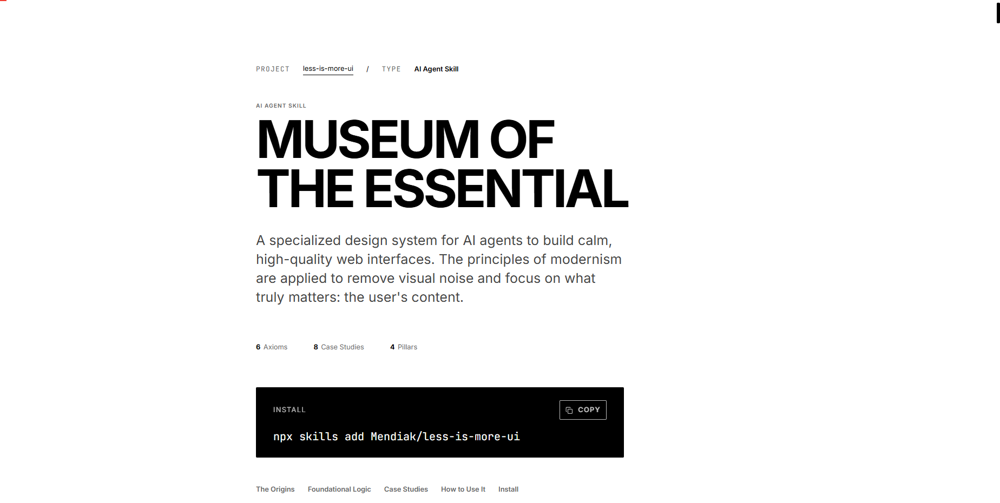

# Less Is More UI

> "Good design is as little design as possible." — Dieter Rams

<p>
  <a href="https://www.npmjs.com/package/@mendiak/less-is-more-ui"></a>
  <a href="LICENSE"></a>
  <a href="https://mendiak.github.io/less-is-more-ui/"></a>
</p>

A minimalist design system and an AI agent skill for calm, functional web interfaces. Design tokens, a CSS reset and reusable components, plus a written set of principles an agent can apply when building or reviewing a UI.

**[Showcase](https://mendiak.github.io/less-is-more-ui/)** · **[Documentation](https://mendiak.github.io/less-is-more-ui/docs/)** · **[Case studies](https://mendiak.github.io/less-is-more-ui/case-studies/)** · **[Notes](https://mendiak.github.io/less-is-more-ui/notes/)**



## The problem

Most generated interfaces look the same: rounded cards, soft shadows, gradients and a hierarchy built from containers. They ask the user to decode packaging before reaching content.

## The solution

Modernist constraints that force content and function to the front:

- **Rational layouts** built on one grid, with generous whitespace instead of decorative containers.
- **Typography-first hierarchy** where type, not colour, carries the structure.
- **Restrained palettes** where colour reports state instead of decorating.
- **Systematic spacing** from a single 8px scale.
- **Honest materials**: semantic HTML, no fake depth.

## Quick start

### As an AI agent skill

```bash
npx skills add Mendiak/less-is-more-ui
```

The skill installs `SKILL.md`, the principle documents and the design tokens into your agent's skills directory. From then on, prompts such as *"simplify this dashboard"* are answered with the axioms and the system applied by default.

### As a CSS package

```bash
npm install @mendiak/less-is-more-ui
```

```css
/* Everything: tokens + reset + components */
@import "@mendiak/less-is-more-ui";

/* Or only what you need */
@import "@mendiak/less-is-more-ui/references/tokens.css";
@import "@mendiak/less-is-more-ui/assets/css/reset.css";
@import "@mendiak/less-is-more-ui/assets/css/components.css";
```

| Package file | Description |
|--------------|-------------|
| `references/tokens.css` | Modular type scale, 8px spacing scale, neutral palette, semantic aliases (`--ui-text`, `--space-2`, `--step-0`…) and dark/light themes |
| `assets/css/reset.css` | Minimal box-sizing reset and base element normalisation |
| `assets/css/components.css` | Buttons, inputs, cards, navigation, filters, specification lists and icons |
| `index.css` | Entry point that imports the three files above |

`style.css` and `docs.css` are **not** part of the npm package: they only style this website.

## Documentation

The full guides are published at [mendiak.github.io/less-is-more-ui/docs](https://mendiak.github.io/less-is-more-ui/docs/):

- [Getting started](https://mendiak.github.io/less-is-more-ui/docs/getting-started/)
- [Principles and axioms](https://mendiak.github.io/less-is-more-ui/docs/principles/)
- [Typography](https://mendiak.github.io/less-is-more-ui/docs/typography/) · [Grid](https://mendiak.github.io/less-is-more-ui/docs/grid/)
- [Components](https://mendiak.github.io/less-is-more-ui/docs/components/)
- [Responsive](https://mendiak.github.io/less-is-more-ui/docs/responsive/) · [Animation](https://mendiak.github.io/less-is-more-ui/docs/animations/)
- [Accessibility](https://mendiak.github.io/less-is-more-ui/docs/accessibility/) · [Anti-patterns](https://mendiak.github.io/less-is-more-ui/docs/anti-patterns/)

The same pages are generated from the Markdown in `docs/` and `references/`, so the skill and the website never drift apart.

## Using it with an agent

Once the skill is active, direct the agent with intent rather than style:

- *"Refactor this dashboard following the Less Is More principles."*
- *"Simplify this landing page: use only the scale variables and remove decorative elements."*
- *"Build a contact form using the Honest Materials precept (semantic HTML only)."*

## Repository structure

```text
.
├── SKILL.md                 # Skill entry point and agent instructions
├── index.css                # npm entry point (tokens + reset + components)
├── assets/
│   ├── css/
│   │   ├── reset.css        # Published package
│   │   └── components.css   # Published package
│   └── images/              # Screenshots used by the README and the site
├── references/              # Skill reference material (+ tokens.css)
├── docs/                    # Skill guides (source of truth for the site)
├── agents/                  # Agent interface metadata
├── evals/                   # Evaluation prompts
├── site/                    # Website source (not part of the npm package)
│   ├── index.html           # Showcase
│   ├── 404.html
│   ├── build.mjs            # Markdown → HTML, sitemap, llms.txt (no dependencies)
│   ├── serve.mjs            # Local preview at /less-is-more-ui/
│   ├── pages.mjs            # Page registry and routes
│   ├── templates/layout.html
│   ├── content/             # New pages and notes
│   └── assets/              # Site-only CSS and JS
├── .github/workflows/       # Build and deploy to GitHub Pages
└── _site/                   # Build output (git-ignored)
```

## Local development

Requires Node 18 or newer. There are no dependencies to install.

```bash
npm run build     # generate _site/
npm run serve     # preview at http://localhost:8080/less-is-more-ui/
npm run preview   # build and serve
```

The `_site/` directory is generated and never committed. To add a page, create a Markdown or HTML file under `site/content/`, register it in `site/pages.mjs`, and run `npm run build`. The builder updates the navigation, breadcrumbs, pagination, `sitemap.xml`, `llms.txt` and `llms-full.txt`.

## Deployment

GitHub Pages is deployed by the workflow in `.github/workflows/pages.yml`: it runs the build and publishes `_site/` as an artifact.

One-time setup: **Settings → Pages → Build and deployment → Source: GitHub Actions**.

## SEO and analytics

- Canonical URLs, `robots` directives, Open Graph/Twitter cards and schema.org structured data (`WebSite`, `Person`, `SoftwareApplication`, `TechArticle`, `WebPage`, `BreadcrumbList`, `FAQPage`).
- Generated `sitemap.xml` (every page) and `robots.txt`.
- `llms.txt` and `llms-full.txt` give agents a compact index and the full documentation in plain Markdown.
- Google Search Console verification via meta tag.
- Google Tag Manager with a dependency-free event layer: install copies, outbound clicks, navigation, section views, scroll depth, code copies, FAQ opens and theme changes.

## Contributing

Issues and pull requests are welcome. A report with a concrete screen and a concrete problem is more useful than an abstract suggestion. If you change a rule, update the corresponding Markdown in `docs/` or `references/` — the website is generated from it.

## License

[GNU GPL v3.0](LICENSE) © [Mikel Aramendia](https://mendiak.github.io/portfolio/)

## Credits

The principles referenced throughout come from Ludwig Mies van der Rohe, Louis Sullivan, Dieter Rams, Jony Ive, Josef Müller-Brockmann and Massimo Vignelli. The mistakes in applying them are the author's.
